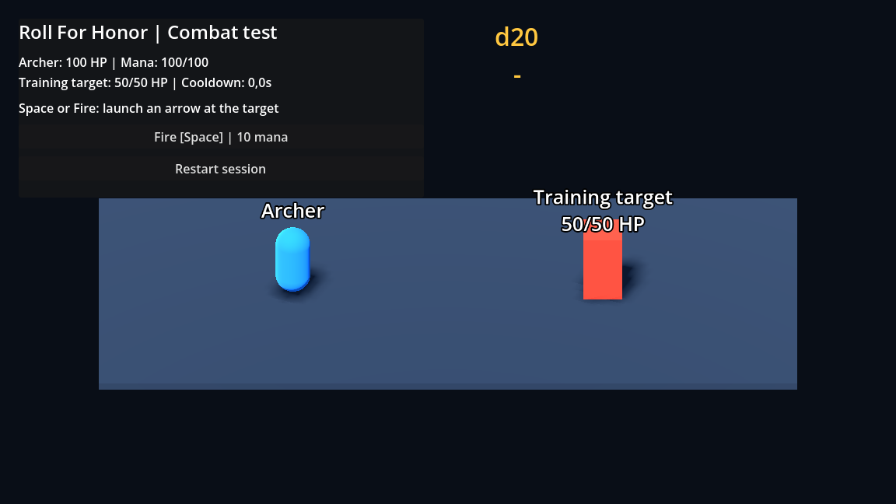
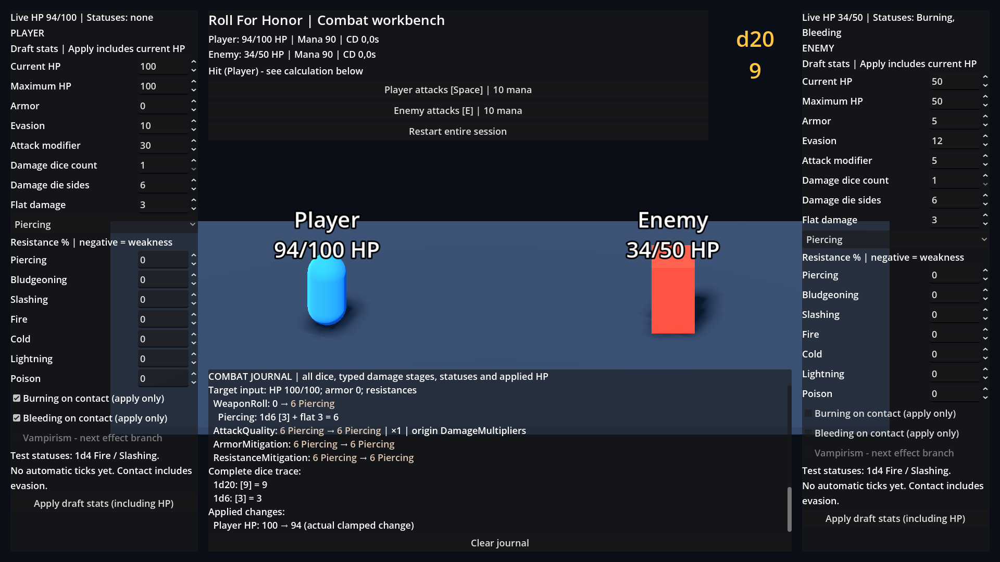
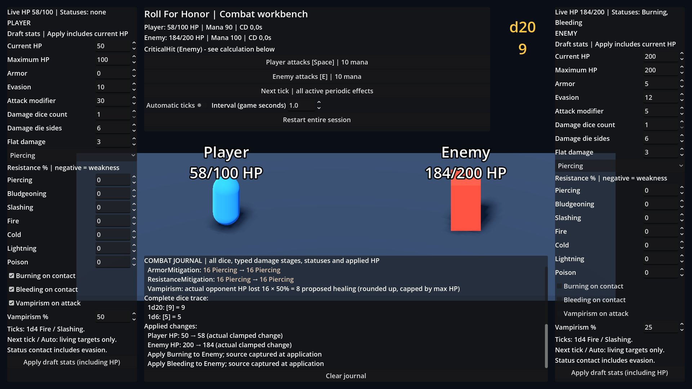

# Visual development history

Real screenshots of the running Godot project, preserved alongside development
milestones. These are development evidence, not concept images or a substitute
for automated tests. Earlier captures remain unchanged as the scene evolves.

## 2026-11-17 — I05 combat scene and editable workbench

Scene: `godot/Game.tscn`, hosted by `Bootstrap.tscn`.
Engine: Godot 4.7.2 .NET, Compatibility renderer, NVIDIA GeForce RTX 3060.
Screenshots were captured from the running viewport and visually inspected.

| Capture | Stage | Resolution | Source state |
| --- | --- | --- | --- |
| [Initial scene](2026-11-17/01-initial-scene.png) | Two combat objects, camera, lighting and basic HUD | 1152×648 | Initial I05 slice, subsequently published in PR #21; reference `4701fa4` |
| [Projectile flight](2026-11-17/02-projectile-flight.png) | Accepted launch and visible projectile | 1152×648 | Initial I05 slice |
| [Initial impact](2026-11-17/03-initial-impact.png) | Changed target HP, mana and separate d20 | 1152×648 | Initial I05 slice |
| [Editable workbench](2026-11-17/04-editable-workbench.png) | Both stat editors and detailed journal layout | 1920×1080 | Local expansion after `4701fa4`; uncommitted when captured |
| [Workbench combat journal](2026-11-17/05-workbench-combat-journal.png) | Exchanged attacks, applied Burning/Bleeding statuses and calculation details | 1920×1080 | Local expansion after `4701fa4`; uncommitted when captured |

The expanded workbench exposes status application only; these frames do not
demonstrate automatic periodic ticks or vampirism. Dice results vary per launch.

### Initial combat slice

### Expanded workbench after exchanged attacks

## 2026-11-17 — I06 vampirism and periodic rounds

Scene/engine/renderer are unchanged. These 1920×1080 viewport captures were made
from local, uncommitted I06 work in `feature/i06-lifesteal-and-periodic-ticks`,
based on I05 merge `09c58f2`. Older I05 captures remain unchanged.

| Capture | Observed state |
| --- | --- |
| [Vampirism](2026-11-17/06-lifesteal-impact.png) | An injured player attacks with 50% vampirism and gains HP from actual enemy HP loss; the journal shows the calculation |
| [Manual round](2026-11-17/07-manual-periodic-tick.png) | Next tick independently applies Burning and Bleeding damage without another d20 or mana charge |
| [Automatic rounds](2026-11-17/08-automatic-periodic-ticks.png) | Automatic mode advances those same effects at a 0.5-game-second interval |

These frames demonstrate actual tick damage, unlike the application-only I05
captures. Effects retain captured sources; the demo has no duration/expiry policy.
Dice totals and resulting HP vary between captures and runs.

