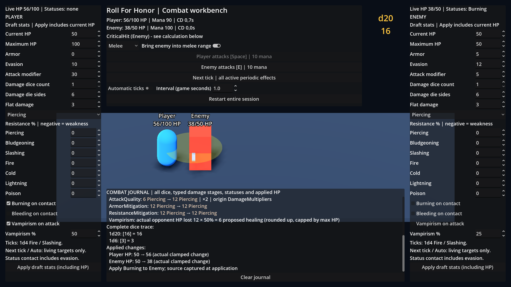
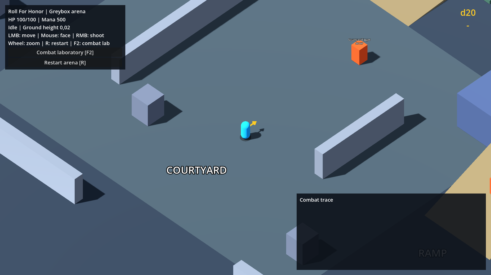
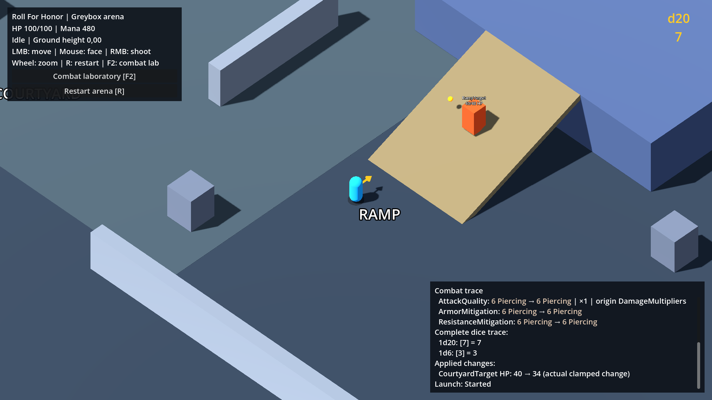
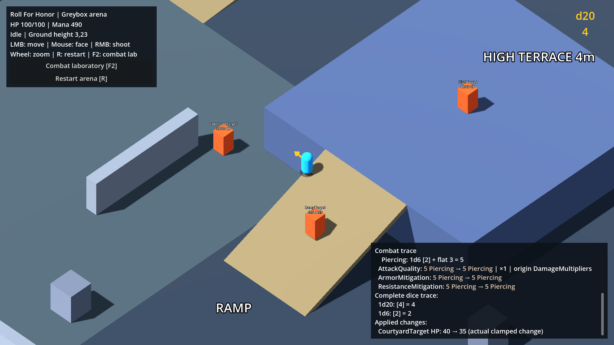

# Visual development history

Real screenshots of the running Godot project, preserved alongside development
milestones. These are development evidence, not concept images or a substitute
for automated tests. Earlier captures remain unchanged as the scene evolves.

## 2026-11-17 — I05 combat scene and editable workbench

Scene: `godot/Game.tscn`, hosted by `Bootstrap.tscn`.
Engine: Godot 4.7.2 .NET, Compatibility renderer, NVIDIA GeForce RTX 3060.
Screenshots were captured from the running viewport and visually inspected.

| Capture | Stage | Resolution | Source state |
| --- | --- | --- | --- |
| [Initial scene](2026-11-17/01-initial-scene.png) | Two combat objects, camera, lighting and basic HUD | 1152×648 | Initial I05 slice, subsequently published in PR #21; reference `4701fa4` |
| [Projectile flight](2026-11-17/02-projectile-flight.png) | Accepted launch and visible projectile | 1152×648 | Initial I05 slice |
| [Initial impact](2026-11-17/03-initial-impact.png) | Changed target HP, mana and separate d20 | 1152×648 | Initial I05 slice |
| [Editable workbench](2026-11-17/04-editable-workbench.png) | Both stat editors and detailed journal layout | 1920×1080 | Local expansion after `4701fa4`; uncommitted when captured |
| [Workbench combat journal](2026-11-17/05-workbench-combat-journal.png) | Exchanged attacks, applied Burning/Bleeding statuses and calculation details | 1920×1080 | Local expansion after `4701fa4`; uncommitted when captured |

The expanded workbench exposes status application only; these frames do not
demonstrate automatic periodic ticks or vampirism. Dice results vary per launch.

### Initial combat slice

### Expanded workbench after exchanged attacks

## 2026-11-17 — I06 vampirism and periodic rounds

Scene/engine/renderer are unchanged. These 1920×1080 viewport captures were made
from local, uncommitted I06 work in `feature/i06-lifesteal-and-periodic-ticks`,
based on I05 merge `09c58f2`. Older I05 captures remain unchanged.

| Capture | Observed state |
| --- | --- |
| [Vampirism](2026-11-17/06-lifesteal-impact.png) | An injured player attacks with 50% vampirism and gains HP from actual enemy HP loss; the journal shows the calculation |
| [Manual round](2026-11-17/07-manual-periodic-tick.png) | Next tick independently applies Burning and Bleeding damage without another d20 or mana charge |
| [Automatic rounds](2026-11-17/08-automatic-periodic-ticks.png) | Automatic mode advances those same effects at a 0.5-game-second interval |

These frames demonstrate actual tick damage, unlike the application-only I05
captures. Effects retain captured sources; the demo has no duration/expiry policy.
Dice totals and resulting HP vary between captures and runs.

## 2026-11-17 — C10 melee hitbox/hurtbox slice

Captured with Godot 4.7.2 .NET and the Compatibility renderer at 1920×1080,
from local uncommitted `feature/c10-melee-hitbox-and-hurtbox` work based on I06
merge `b27e2b3`. Earlier screenshots remain unchanged.

| Capture | Observed state |
| --- | --- |
| [Melee window](2026-11-17/09-melee-hitbox-window.png) | Melee delivery selected, enemy moved into range, visible swing/range indicator and committed damage/healing/status facts |
| [Window finished](2026-11-17/10-melee-window-finished.png) | The timed swing has closed and its visual is removed; committed state remains |

The swing is a greybox timed test visual, not a final animation rig. These
images demonstrate the close-range fixture; additional engine tests verify
multi-target contacts and reentry admission. The future greybox map, mouse-facing
movement and terrain-following projectile behavior are not implemented here.

## 2026-11-17 — G01 greybox movement, mouse facing and terrain delivery

Scene: `godot/Arena.tscn`, hosted by `Bootstrap.tscn`. Godot 4.7.2 .NET,
Compatibility renderer, NVIDIA GeForce RTX 3060, actual 1920×1080 viewport.
Captured and visually inspected from local uncommitted
`feature/g01-greybox-movement-and-aiming` work based on merge `add287b`.
Earlier captures remain unchanged. The combat laboratory remains separately
available through `WorkbenchBootstrap.tscn` or F2.

| Capture | Observed state |
| --- | --- |
| [Arena startup](2026-11-17/11-g01-greybox-arena.png) | Following camera, colored geometry, actor arrow, terrain marker and mouse control hints |
| [Projectile impact](2026-11-17/12-g01-projectile-impact.png) | One mana charge, actual target HP change, separate d20 and detailed calculation journal |
| [Ramp and terrain](2026-11-17/13-g01-ramp-and-terrain.png) | Player at the high ramp entrance with a target on the slope; actor was repositioned for this framing |
| [Projectile over ramp](2026-11-17/14-g01-projectile-over-ramp.png) | A second accepted shot follows the slope at its ground offset while the player remains at the entrance |

Images demonstrate rendered states. Actual click navigation around a wall and
from the side of the high terrace via its ramp, yaw-only aiming, collision and
fixed projectile clearance are additionally verified by the engine tests.
Targets are stationary fixtures; these images do not demonstrate enemy AI.
Dice and HP totals vary between runs.

## 2026-11-17 — G01 airborne projectile revision

The user rejected the ground-following appearance after trying the arena.
Captures 11–14 remain historical evidence of that superseded prototype.
The revised `AirborneProjectile` flies along its initial 3D direction; terrain
and walls stop it through actual swept collision rather than a height guard.
The ramp-edge regression failed before this revision and passes afterward.

Same branch/base, local uncommitted status, engine, Compatibility renderer and
1920×1080 viewport as the preceding G01 captures. Actors were repositioned to
stage the elevation examples; launches and impacts use actual mouse input and
the existing combat services. All three frames were visually inspected.

| Capture | Observed state |
| --- | --- |
| [Downward flight](2026-11-17/15-g01-airborne-downward-flight.png) | A shot leaves the side of the ramp toward a lower target instead of ending at the terrain-height transition |
| [Downward impact](2026-11-17/16-g01-airborne-downward-impact.png) | That same shot reaches the lower target; HP, d20 and detailed journal show the committed result |
| [Upward flight](2026-11-17/17-g01-airborne-upward-flight.png) | A second shot travels toward an elevated target at the near edge of the high terrace |

## 2026-11-17 — G01 WASD controls

The user replaced click movement with physical WASD keys relative to the camera.
Mouse-facing and right-click shooting remain independent of held movement keys.
Click navigation and its unused navigation mesh were removed. Earlier images
retain the controls that existed at their capture time.

[WASD movement](2026-11-17/18-g01-wasd-movement.png) shows actual W input, the
Moving state, independent facing and updated HUD instructions. Captured and
visually inspected at 1920×1080 with Godot 4.7.2 .NET, Compatibility renderer,
from the same local uncommitted G01 branch based on `add287b`.
Engine tests verify all four keys, diagonal speed, braking after release and
left-click inactivity; the complete engine suite passes all 38 cases.

## 2026-11-17 — G01 cursor surface alignment

The marker now queries actors, obstacles and terrain through the same ray used
for attack aiming, excluding the source actor. It is offset along the observed
normal and oriented to the surface, including vertical faces. Actor rotation
remains yaw-only. The complete engine suite passes all 40 tests.

| Capture | Observed state |
| --- | --- |
| [Target surface](2026-11-17/19-g01-cursor-on-target.png) | The gold marker lies on the target's visible body face |
| [Wall surface](2026-11-17/20-g01-cursor-on-wall.png) | The marker rotates onto the courtyard wall instead of appearing on the floor behind it |

Both real viewport frames were visually inspected at 1920×1080 with Godot
4.7.2 .NET, Compatibility renderer, from the same local uncommitted G01 branch
based on `add287b`. The capture helper samples fixed camera coordinates through
the actual cursor-query component with hardware polling disabled for framing.
